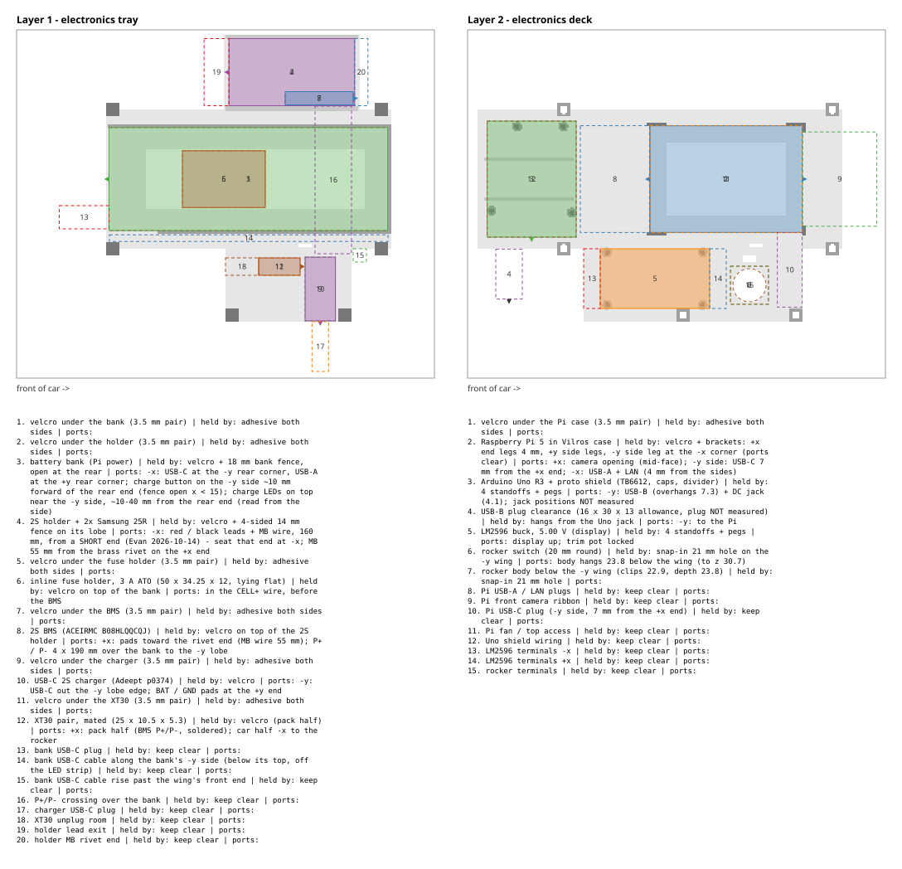

# Electronics layout - where every part goes (2026-10-13)

**Status: PLAN, UNTESTED.** Nothing here has been printed or fitted. Parts
and positions come from the `LAYOUT` lists in
`cad/scad/electronics_tray.scad` (layer 1) and `cad/scad/electronics_deck.scad`
(layer 2); `scripts/electronics_layout.py` reads them, checks them against
the rendered STLs and draws `docs/electronics_layout.svg`. Change a position
in the .scad, never here, then re-run the script. Record: the entry of
2026-10-13 that introduced this file.

**Frame (mm):** x along the car, x = 0 at the rear corner pin hole of the
centre frames, **+x = front**; y across, +y = the car's left (up in the drawing);
z = 0 on the Lego frames' top face. Layer 1 sits on the tray floor (z 9.8);
layer 2 on the deck (underside z 32.0, top z 34.5; raised 2 mm on 2026-10-13
so the 2S holder clears it).

## Layer 1 - electronics tray

| # | Part | Box x .. / y .. / z .. | Held by | Ports / leads |
|---|---|---|---|---|
| 1 | Power bank (Pi only) 151.5 x 70.55 x 18.0 | -4..147.5 / -35.3..35.3 / 9.8..27.8 | bank fence (open rear) | USB-C + USB-A on the REAR end (-x), 20 / 45 mm from the left |
| 2 | 2S holder + 2x Samsung 25R, 75.75 x 40.5 x 20.5 | 58.1..133.9 / 37.9..78.4 / 9.8..30.3 | holder fence + 2 zip ties (slots x 75, 117) | red / black leads + the MB wire soldered to the series strap; lead end NOT measured |
| 3 | USB-C 2S charger (Adeept p0374) 38.5 x 18.5 x 6.3 | 60..98.5 / -69.5..-51 / 9.8..16.1 | zip ties at x 64 and 92 | USB-C toward -x (lobe edge) - confirm on the board |
| 4 | 2S BMS (ACEIRMC) 41 x 8 x 2.2 | 66..107 / -83..-75 / 9.8..12.0 | double-sided tape | pads B+ B- MB P+ P- |
| 5 | ZONE: 3 A ATO fuse holder (body NOT measured) | 108..123 / -84..-74.5 / to 24.8 | tape, or the tie at x 120 | inline on CELL+, before the BMS |
| 6 | ZONE: XT30 pair (mated length not stated) | 102..128 / -69..-52 / to 20.8 | zip tie at x 120 | BMS P+/P- side; car side goes to the rocker |

## Layer 2 - electronics deck

| # | Part | Box x .. / y .. / z .. | Held by | Ports |
|---|---|---|---|---|
| 1 | Raspberry Pi 5 in Vilros case 91.8 x 64.4 x 27.2 | 55.1..146.9 / -32.2..32.2 / 34.5..61.7 | 4 corner brackets, +0.25 per side | FRONT (+x): camera connector + USB-C power; REAR (-x): 2x USB-A + LAN |
| 2 | Arduino Uno R3 + proto shield (TB6612 on headers, 470 uF + 0.1 uF, 100k/12k divider) | -2..51.3 / -34.3..34.3 / 38.5..(height NOT measured) | 4 standoffs + pegs | USB-B + DC jack on the -y end |
| 3 | LM2596 buck, 5.00 V, with display, 66 x 36 x 14 | 62..128 / -78..-42 / 37.5..51.5 | 4 standoffs + pegs | display up; trim pot set to 5.00 V unloaded, then locked |
| - | Rocker switch, 20 mm round | hole at (-18, -32) on the rear tab | snap-in | body hangs BELOW the tab, behind the tray - depth NOT measured |

## Every part you have, accounted for

Evan's 2026-10-10 arrival list (record FI; items 2, 10, 13, 14, 17 are row 16
of the order sheet, numbered in FI's order), plus what was already owned or
came later.

| Item | Piece | Goes |
|---|---|---|
| 1 | 2S BMS (8-pack; 1 used) | layer 1 #4 |
| 2 | 22 AWG wire | harness (all power and signal, BOM row 16) |
| 3 | Standard-Mini 200 mm camera cable | Pi front -> camera mast |
| 4 | Pololu #4763 6-pin JST SH cable | motor -> shield (motor power + encoder) |
| 5 | Vilros Pi 5 kit | Pi in its case = layer 2 #1 (SD card inside); PSU / HDMI adapter stay off the car |
| 6 | Fuse holder + fuses | layer 1 zone #5 |
| 7 | WS2812B reel | two short segments at the car's front and rear, fed from the shield |
| 8 | Rocker switch | deck rear tab |
| 9 | XT30 | layer 1 zone #6 |
| 10 | 470 uF caps | on the shield at the TB6612, and at the strip feed point |
| 11 | TB6612 carrier | on the shield (layer 2 #2) |
| 12 | LM2596 (2-pack; 1 used) | layer 2 #3 |
| 13 | 0.1 uF caps | on the shield at the TB6612 |
| 14 | Heat shrink | harness |
| 15 | MG90D-270 (4-pack; 1 used) | servo mount |
| 16 | Adeept charger | layer 1 #3 |
| 17 | Headers | on the shield (TB6612 socket) |
| 18 | Dupont jumpers | harness / servo lead extension if it is short |
| 19 | Proto shield | on the Uno (layer 2 #2) |
| 20 | Resistor kit | divider 100k + 12k on the shield; strip series resistor |
| 21 | 2S holder | layer 1 #2 |
| 22 | 18650 cells | in the holder |
| owned | Arduino Uno R3 clone | layer 2 #2 |
| owned | Power bank 5 V / 3 A | layer 1 #1 |
| owned | Data-only USB cable | Pi USB-A -> Uno USB-B |
| later | Pololu #5159 motor | motor mount |
| in shipping | Camera Module 3 Wide | camera mast |

Spares that stay off the car: 7 BMS boards, 1 LM2596, 3 servos, the rest of
the WS2812B reel and the fuses.

## Cable routes (planned, lengths are estimates)

| From -> to | Route | ~Length |
|---|---|---|
| Holder red -> fuse -> BMS B+; black -> B-; MB -> MB | out of the holder, across OVER the bank (4.2 mm under the deck), down into the -y lobe | 120-150 mm |
| Charger BAT+/BAT- -> BMS P+/P- | inside the -y lobe | short |
| BMS P+/P- -> XT30 (pack side) | inside the -y lobe | short |
| XT30 (car side) -> rocker -> VBAT | up the -y lobe's outer edge onto the deck wing, back along the deck to the rear tab; VBAT then to the shield (TB6612 VMOT, LM2596 VIN, divider top) | ~190 mm |
| LM2596 VOUT -> shield `+5V2` | deck wing -> shield | short |
| Bank USB-C -> Pi USB-C | from the bank's REAR end, up behind the deck, forward along the deck's +y side to the Pi's front | ~220 mm - check a 25-30 cm USB-C cable is on hand |
| Pi USB-A -> Uno USB-B | Pi rear end -> Uno's -y end, on the deck | short |
| Motor + encoder (#4763) | motor below the frames -> -y rail notch (x 100..108) -> under the tray floor -> up the floor + deck slot (x 100..108, y -41..-38.5) -> shield | ~165 mm of 300 (record HE) |
| Servo lead | servo (tray x ~170) -> along the deck -> shield | ~150-200 mm - lengthen with jumpers if short |
| Camera cable | Pi front -> camera mast | 85-110 mm of 200 (record HE) |
| Strip segments | shield -> car front / rear | per segment |

Wiring rules live in `docs/WIRING_PROTOSHIELD.md` (section 2.1: nothing but
the BMS touches B+ / MB / B-; star ground at the TB6612 GND pad).

## Verification (2026-10-13)

`./.venv/Scripts/python.exe scripts/electronics_layout.py`: 10 entries, 0
checks failed - no part or zone box contains printed material (tray or
deck), no two boxes overlap, every box rests on printed material, and the
gap from each layer-1 top to the deck underside is 1.7 mm (holder), 4.2 mm
(bank), 7.2 (fuse zone), 11.2 (XT30 zone), 15.9 (charger), 20.0 (BMS).

What this does NOT prove: any fit (unprinted), the unmeasured sizes (fuse
holder body, XT30 mated length, Uno + shield height, rocker depth), the
charger's port side, or that the cables reach.

## Still to measure

- Fuse holder body; XT30 mated length; Uno + shield height with the TB6612
  and caps fitted; rocker body depth below the panel.
- Charger: which edge its USB-C is on.
- Holder: which end its leads leave from.
- The servo lead length.
