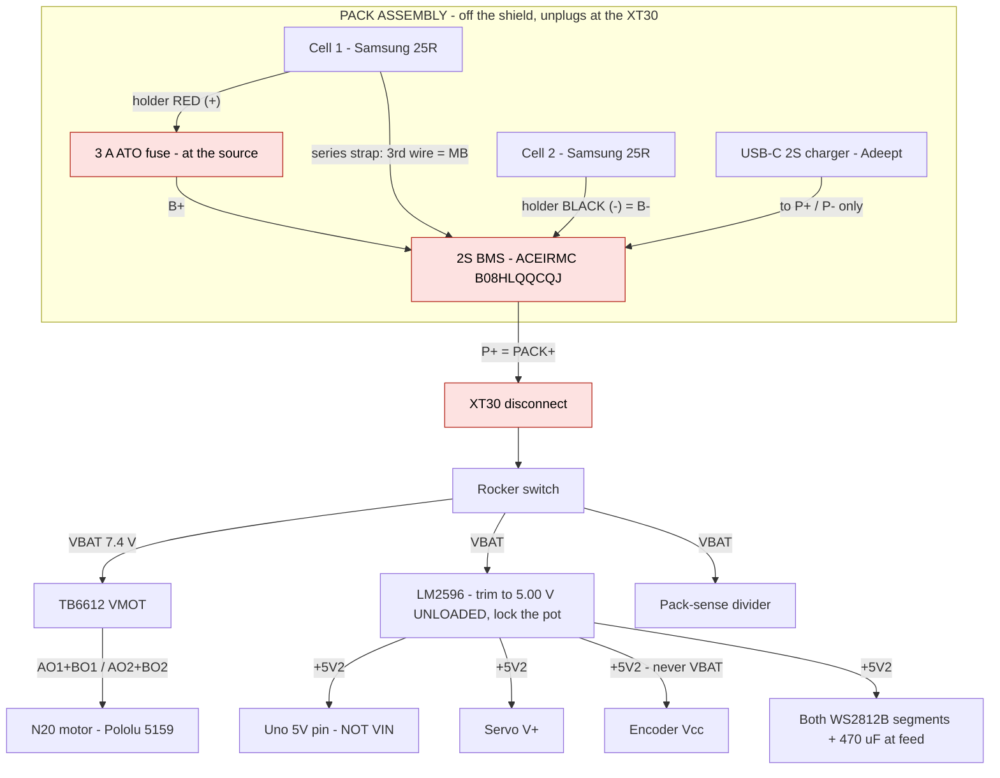
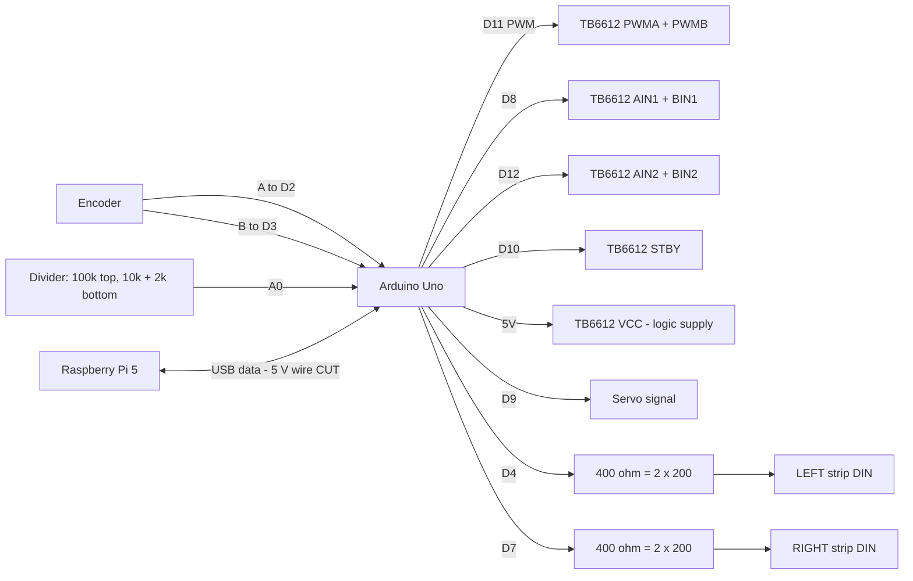
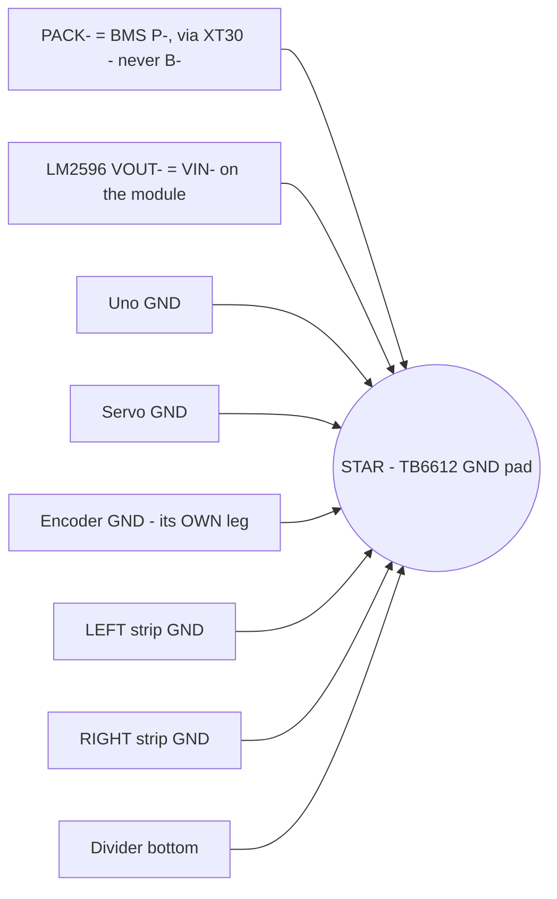
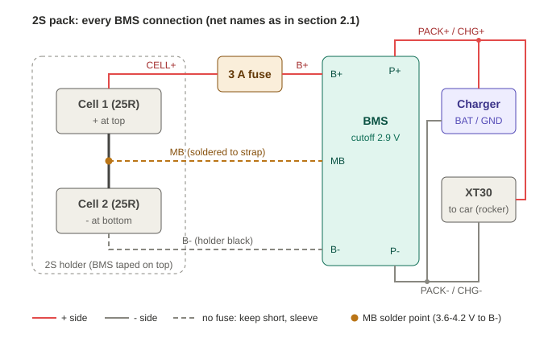

# Proto-shield wiring — the buildable schematic

~~**Status: DESIGN, nothing is built and nothing is ordered.**~~ **Status 2026-10-11: parts ARRIVED 2026-10-10 (record Appendices FI-FW); nothing is wired or metered yet. Audited 2026-10-11; every fix is marked "audit 2026-10-11".** Written
2026-09-02 ~17:30 CDT. **Vetted end-to-end and rewritten 2026-09-03 ~20:30 CDT
(Appendix DA)** — the lighting scheme changed from 8 discrete LEDs to two
WS2812B strip segments, which invalidated §2.5 outright and touched §1, §2.1,
§3, §5 and §6. The vet also found §2.2 naming the wrong motor (#1093, the
no-encoder part) three weeks after §4.3 recorded that exact correction, and
§6 citing a car width superseded a day earlier. This is the point-to-point net
list for an **Arduino proto shield** carrying every connection between the Uno,
the TB6612, the motor/encoder, the servo, the lights and the pack.

**2026-10-10: the pack path is redrawn with the BMS in the circuit (section 2.1), and three diagrams now sit at the top of section 2.** Until this date the net list wired the holder straight to the fuse, bypassing the over-discharge cutoff (Appendix FA).

**It is deliberately not a PCB.** ~~Not one component in this document has ever
been in Evan's hands — no TB6612, no LM2596, no MG90S, no N20, no encoder.~~ (Parts in hand since 2026-10-10; none wired.) A
board laid out now is a board laid out against datasheet drawings. Writing the
net list first cost nothing and **found four defects** (§4), any one of which
would have shipped into a PCB rev-1 and cost a two-week respin. When this
document has been built and driven, it becomes the verified schematic a PCB
gets spun from — see §7 for exactly what changes at that point.

Companion docs: pin map + protocol `firmware/SERIAL_PROTOCOL.md` · parts and
prices `docs/BOM.md` · light channels `docs/LIGHTING_SPEC.md` (rewritten for WS2812B 2026-09-03, Appendix DC; a stale warning that said otherwise was struck (audit 2026-10-11)) · power architecture
`docs/research/2026-07-23_power-system.md`.

---

## 1. What sits on the shield

| # | On the shield | Notes |
|---|---|---|
| 1 | Pololu #713 TB6612FNG carrier | soldered on 0.1" header, **not** flying leads |
| 2 | LM2596 buck module @ ~~5.2 V~~ **5.0 V** (audit 2026-10-11) | module, wired in — has its own trim pot, set it BEFORE connecting anything, then **lock the pot** with a dab of glue or nail polish |
| 3 | SPST rocker switch (or its leads to a panel mount) | switches the pack, not the Pi |
| 4 | 470–1000 µF electrolytic + 0.1 µF ceramic | across VM/GND, physically at the TB6612. **Plus a second 470 µF across `+5V2`/GND at the strip feed point (added 2026-09-03)** — WS2812B pixels switch their drivers in step, and the strips sit at the end of a lead; without local bulk that step lands on the `+5V2` rail, which also feeds the Uno. **Electrolytics are polarised: the striped (-) leg goes to GND** (audit 2026-10-11) |
| 5 | 2 × WS2812B data-line resistors, ~330–470 Ω | **2026-10-04: the kit has nothing in 330-470 ohm - use 2 x 200 ohm in series (400 ohm) for each.** one in series with each segment's `DIN`. **Superseded the 8 per-LED resistors 2026-09-03 (Appendix CX)** — every WS2812B pixel has its own constant-current driver, so per-LED ballast no longer exists as a concept |
| 6 | Pack-sense divider: 100 kΩ + 12 kΩ | ratio 0.10714, per `firmware/uno_packguard/`. **2026-10-04: the kit (BOM row 19) has no 12 kohm - build it as 10 kohm + 2 kohm in series, exactly 12.0 kohm. Do NOT use 10 kohm alone: the ratio drops to 0.0909 and the firmware under-reads the pack by 15%.** |
| 7 | Screw terminals or JST for every off-board lead | motor+encoder, servo, **2 × strip segment (3 conductors each: `+5V2`, `DIN`, GND)**, pack |
| 8 | *(off the shield)* Pack assembly: 2S holder, 3 A fuse, 2S BMS, USB-C charger | added 2026-10-10. Lives with the pack and unplugs at the XT30 - section 2.1. Nothing on the shield connects to the BMS's B+ / MB / B- |

**Zero flying Dupont jumpers is the point of the exercise.** Dupont crimps back
out under vibration, and this vehicle vibrates. Every off-board connection
lands in a screw terminal or a latching connector.

---

## 2. Net list

**22 AWG for every net, signal and power (Evan, 2026-10-04; `BOM.md` row 16;
was: "Signal wire ~26 AWG; motor and pack wire ~22 AWG").** 26 AWG was dropped:
22 AWG is never worse electrically (signal nets carry mA) and it grips a screw
terminal better than 26 AWG strands. The two signal runs that would have been
awkward never come off the spool - the encoder uses the pre-made Pololu #4763
JST SH cable (row 5b) and the servo ships its own 3-wire lead.

**Build note:** 22 AWG stranded silicone (~1.7 mm OD with insulation) will NOT
thread THROUGH a 0.1" protoboard hole. Strip it and solder onto the pad.

~~**WARNING (2026-10-04): the net list below does NOT include the BMS** (BOM row
11b, ACEIRMC `B08HLQQCQJ`, added 2026-09-03 in Appendix CK). As written,
`PACK+` runs from the holder straight to the fuse, so **wiring from this table
leaves the pack with NO over-discharge cutoff** - the exact hole CK closed.
Until the nets are redrawn, the rule is fixed by the board itself: the pack
connects to the BMS's **B+ / B- / MB** pads, and **everything else - switch,
loads AND the charger - connects to P+ / P-**, never to B+ / B- (anything on
B- or B+ bypasses the protection). **MB is the midpoint between the two
cells**, and the DIANN holder (row 10) exposes only two leads, so a third wire
must be soldered to its internal series strap. Where the 3 A fuse sits relative
to the BMS is part of the redraw. Redrawing these nets is an OPEN task.~~ **RESOLVED 2026-10-10: section 2.1 now routes the pack through the BMS, with the fuse on the cell side (Evan's call).**

### 2.0 Diagrams (added 2026-10-10)

Three small diagrams, one question each - one combined drawing was tried first and was unreadable (20 nodes, ~35 crossing lines). **The tables below stay the authority on pins and wire;** these are the map. Every Uno pin NUMBER matches `firmware/uno_control/uno_control.ino:82-95` (and A0 at `packguard.h:23`). The 2026-10-10 script compared pin numbers only; the 2026-10-11 audit checked each pin's FUNCTION by hand - all agree. Not re-rendered after the 2026-10-11 edits.

#### Power - where every volt comes from

#### Signals - every Uno pin (matches `uno_control.ino:82-95`)

#### Ground - one star, every return on its own leg

### 2.1 Pack and power distribution

**2026-10-14 (record IO): every BMS connection, one picture** - `docs/bms_wiring.svg`. The table below stays the authority. Physically the BMS now sits ON TOP of the 2S holder so the two unfused leads (B-, MB) stay short; only the fused, BMS-protected P+ / P- cross the bank to the charger and the XT30 (lengths: `docs/ELECTRONICS_LAYOUT.md`, cable routes).

| Net | From | To | Wire | Notes |
|---|---|---|---|---|
| `CELL+` | holder RED (cell 1 +) | 3 A ATO fuse | 22 | **2026-10-10: fuse at the source, BEFORE the BMS** (Evan) - covers the BMS board, its B+ lead and the charge path. **It does NOT cover the MB or B- leads**, which run unfused straight off the cells: keep both short, sleeved and strain-relieved (audit 2026-10-11) |
| `B+` | fuse out | BMS `B+` | 22 | |
| `MB` | holder's internal series strap (cell 1 - / cell 2 +) | BMS `MB` | 22 | **new 3rd wire** - the DIANN holder has only 2 leads, so solder to its strap. Meter 3.6-4.2 V from MB to B- **2026-10-14 (record IQ): the strap is not reachable inside; solder MB to the brass star rivet on the OUTSIDE of the end WITHOUT the leads (Evan's photo) - it holds that end's cell contact, the series node. Meter it first, cells in: rivet to black = 3.6-4.2 V AND rivet to red = 3.6-4.2 V; only then solder, cells OUT.** |
| `B-` | holder BLACK (cell 2 -) | BMS `B-` | 22 | **nothing else ever touches B+ / MB / B-** |
| `CHG+` / `CHG-` | charger `BAT+` / `BAT-` | BMS `P+` / `P-` | 22 | charger on the protected side; keep its USB-C port reachable with the pack installed. Its drain on the pack with no USB plugged in is UNMEASURED |
| `PACK+` | BMS `P+` | XT30 male + | 22 | **2026-10-10: the BMS output** (was holder + -> fuse) |
| `PACK-` | BMS `P-` | XT30 male -, then star ground on the car side | 22 | **never B-** - anything on B- bypasses the protection |
| ~~`PACK+`~~ | ~~2S holder +~~ | ~~3 A ATO fuse holder~~ | ~~22~~ | ~~**Fuse at the pack terminal, before anything else** — it protects the harness, so it goes at the source~~ **SUPERSEDED 2026-10-10 by the BMS rows above** |
| ~~`PACK+F`~~ | ~~fuse out~~ | ~~XT30 male~~ | ~~22~~ | ~~disconnect point~~ **SUPERSEDED 2026-10-10: the fuse moved to the cell side, and the XT30 now takes BMS P+** |
| `PACK+SW` | XT30 female | rocker switch | 22 | on the shield |
| `VBAT` | rocker out | TB6612 `VMOT`, LM2596 `VIN+`, divider top | 22 | the switched 7.4 V rail |
| `+5V2` | LM2596 `VOUT+` | Uno `5V` pin, servo V+, **both strip segments' +5V**, encoder `Vcc` | 22 | **set the trim pot to ~~5.20 V~~ 5.00 V with the module unloaded before connecting anything, then lock the pot** (audit 2026-10-11). The net keeps its name `+5V2`. TB6612 `VCC` hangs off this rail too, through the Uno 5V pin (section 2.2) |
| `GND` | see §3 | — | 22 | single star point |
| `VIN-` / `VOUT-` | LM2596 | joined on the module | 22 | ONE leg to the star; the buck's input return shares it (audit 2026-10-11) |

> ⚠️ **The Uno is fed at its `5V` pin, which BYPASSES the onboard regulator and
> its reverse-protection.** ~~5.2 V is inside spec~~ **5.0 V leaves 0.5 V of margin (5.2 V left only 0.3 V)** (audit 2026-10-11); anything above ~5.5 V kills
> the ATmega, and NOTHING on this rail clamps it - a bumped or failing trim pot is the whole risk, which is why the pot is locked. Meter the LM2596 output before it ever touches that pin. Do not
> connect the LM2596 to `VIN`.

> ⚠️ **The USB cable to the Pi must have its 5 V conductor cut** (`BOM.md`
> row 20). With the shield feeding the Uno's 5V pin, an intact USB 5 V wire
> back-feeds the Pi's bank into the LM2596 rail — two supplies fighting.

> **This cut cable has never been tested on this clone Uno** (an FTDI FT232RL board; whether its USB-serial chip runs from the USB 5 V line is unknown). Section 5 step 1b tests it before anything else is wired. If the link fails, STOP: the power entry needs a redesign (Evan's decision B, 2026-10-11).

> **The USB ground is the ONE deliberate Pi-to-car ground link.** The 5 V conductor is cut; GND is not. While driving, add no second Pi-to-car ground path (HDMI to a monitor, Ethernet to a grounded switch) - it would close a loop around the motor return (audit 2026-10-11).

**Pack current budget (audit 2026-10-11) - an ESTIMATE, not a measurement.** Motor stall 1.6 A (BOM row 5) + the LM2596's input at its worst-case 1.20 A load: 5.0 V x 1.20 A = 6.0 W, / 80% efficiency (ASSUMED, no datasheet figure) = 7.5 W = 1.01 A at 7.4 V, 1.17 A at 6.4 V. **Total ~2.6-2.8 A against the 3 A fuse (87-92%).** Evan kept 3 A (2026-10-11): a sustained stall with the servo moving can nuisance-blow it, which is a SAFE failure. A firmware bug at 100% duty (8.4 V / 3.75 ohm = 2.24 A, plus the buck) exceeds 3 A and blows it - the fuse doing its job. Step 8 records the fuse body temperature.

### 2.2 Motor — TB6612, both channels paralleled

| Net | Uno pin | TB6612 | Notes |
|---|---|---|---|
| `M_PWM` | **D11** | `PWMA` **and** `PWMB` bridged | Timer2. One pin drives both channels |
| `M_DIR1` | **D8** | `AIN1` **and** `BIN1` bridged | |
| `M_DIR2` | **D12** | `AIN2` **and** `BIN2` bridged | |
| `M_STBY` | **D10** | `STBY` | **§4.1 — this net did not exist until 2026-09-02** |
| `VCC` | Uno `5V` | `VCC` | logic supply, 2.7–5.5 V |
| — | — | `AO1` + `BO1` bridged → motor M1 | output side of the parallel |
| — | — | `AO2` + `BO2` bridged → motor M2 | |
| — | — | 0.1 uF ceramic across motor M1 / M2, AT the motor | brush noise; prose below, listed here (audit 2026-10-11) |

**Paralleling is correct — but the reason this section used to give is dead.**
It read "forced, not tidy: there is zero spare PWM, so the B channel *cannot*
be driven independently." That stopped being true on 2026-09-03, when the LED
strip freed D5 and D6 (Appendix CX). **Bridge them anyway**, for the reason
that actually holds and always did: there is one motor, both channels drive
it, and paralleling is what buys the 2 A continuous rating. Pololu states that
rating but **does not document the pin pairing**; the pairing above is standard
practice and is **unverified against the Toshiba datasheet — confirm before
soldering.**

Motor: **Pololu #5159** — *corrected 2026-09-03. This paragraph still said
**#1093**, the no-encoder motor, long after §4.3 recorded the fix and while
§2.3 below wires six encoder conductors. The stall figure was right for either
part; the part number was not.* Stall 1.6 A vs 2 A paralleled continuous, duty
capped ~71 % of a full 8.4 V pack. Add **0.1 µF across the motor terminals**
for brush noise — `BOM.md` row 16 now carries it.

### 2.3 Encoder — Pololu #5159, 6-pin JST SH

Verified against pololu.com/product/5159 on 2026-09-02.

| JST pin | Colour | Function | Goes to |
|---|---|---|---|
| 6 | red | motor M1 | TB6612 `AO1`+`BO1` |
| 5 | black | motor M2 | TB6612 `AO2`+`BO2` |
| 4 | blue | encoder `Vcc` | **`+5V2` — see the warning below** |
| 1 | green | encoder `GND` | star ground |
| 3 | yellow | channel A | Uno **D2** (INT0) |
| 2 | white | channel B | Uno **D3** (INT1) |

> ⚠️ **Encoder `Vcc` MUST come from the `+5V2` rail (5.0 V), never from `VBAT`.** The
> encoder accepts 2.7–18 V, so 7.4 V would work *for the encoder* — and would
> then swing its outputs to 7.4 V into the Uno's 5 V-max input pins. This is a
> silent way to destroy the board. The outputs are pulled to `Vcc` through
> internal 10 kΩ resistors, so **no external pull-ups are needed.**

12 CPR at the motor shaft × 29.86:1 ≈ **358 counts per output-shaft
revolution.** JST SH is 1.0 mm pitch and not hand-solderable to 0.1"
protoboard — buy Pololu's mating cable and solder its far end to the shield.

### 2.4 Steering servo (~~MG90S~~ **HOOYIJ MG90D-270**)

warning: **The whole of 2.4 was written for the MG90S and still names it below.**
BOM row 7 swapped to the HOOYIJ MG90D-270 on 2026-09-05 (Appendix DP) because
the 13-stud rack needs 135 degrees each way, past the MG90S's reach (Appendix
DN). The WIRING is unchanged -- same 3-wire signal/5V/GND, same pin -- so the
table below stands; the PART NAME does not. (propagated 2026-09-09, daily-audit finding 10.)

| Wire | To |
|---|---|
| signal (orange/white) | Uno **D9** |
| V+ (red) | `+5V2` |
| GND (brown/black) | star ground |

Servo peak ~700 mA. Its return current must not share a conductor with the
encoder return (§3). The MG90D-270's rated supply voltage is **not recorded in this repo** - read it off the listing before relying on 5.0 V (audit 2026-10-11).

#### 2.4a The servo-to-pinion coupling — MECHANICAL, and it was missing

*Not electrical, and it does not belong in a wiring document. It is here because
nothing else owned it and it was specified NOWHERE until 2026-09-02 (Appendix
BS) — `BOM.md` row 7 is "MG90S metal-gear servo | Steering" and this section
covered only three wires. Move it when a mechanical assembly doc exists.*

**The steering coupler is the HIGHEST-torque joint on the car, and a printed one
fails.** This is the exact inverse of the drive coupler, which
`docs/research/2026-07-23_drive-motor-selection.md` correctly identified as the
*lowest*-torque joint. Scaling that document's own figure — a printed Lego
cross-axle stub sees **6.64 MPa at the N20's 55.9 mN·m stall**, against
**~15–25 MPa PLA interlayer shear**:

| joint | stall torque | stress | safety factor |
|---|---|---|---|
| N20 drive coupler | 55.9 mN·m | 6.64 MPa | **2.26 – 3.77** |
| **MG90S steering coupler** (historical: the car now uses the MG90D-270, whose stall torque is not recorded) | **~216 mN·m** | **26.1 MPa** | **0.57 – 0.96 — FAILS** |
| ~~MG996R fallback (BOM row 7)~~ no longer a BOM fallback | ~1079 mN·m | 128.3 MPa | **0.12 – 0.19 — fails badly** |

**So a printed cross-axle stub must not be used here**, and the MG996R fallback
makes it roughly 5× worse. Two consequences:

1. **Grip a real Lego axle; never print the cross profile.** The drive-motor
   research already says this for the drive side; here it is not advice, it is
   the difference between a working car and a sheared coupler.
2. **The servo must never reach stall.** At working torque the coupler is fine —
   these numbers are all *stall*. Limiting travel so the servo never drives into
   a Lego hard stop is therefore **not just servo protection, it is what keeps
   the coupler intact.** That is what `SERVO_US_SPAN` (§ `uno_control.ino`) and
   any future centre calibration are actually for.

**(Historical - superseded by the printed coupler, see the CORRECTED note below (audit 2026-10-11).)** **Manufactured option: Adafruit #4252, $0.75** — micro-servo spline to a 16 mm
Lego cross axle. ⚠️ Adafruit will not guarantee the spline fit beyond their own
micro servo, and **it is injection-moulded plastic at the joint that just failed
the printed check.** Injection moulding is stronger than FDM — no interlayer
planes — but no torque rating is published, so it is **unverified, not safe**.
Confirm the spline against a real MG90S, and treat it as working-torque-only.

**Printed alternatives already known:** Printables 61922 / 147626
(`docs/research/2026-07-23_sensor-compute-stack.md` lines 132, 255). Same
caveat: socket gripping a real axle, never a printed cross stub.

~~**UNRESOLVED.** No coupling is chosen. This section states the constraint the
choice must satisfy, not the choice.~~

~~**RESOLVED 2026-09-03 (Appendices DD/DF): Adafruit #4252**, BOM row 22, $0.75.
Evan has built it and reports it strong, which confirms the spline fit on his
real servo. warning: no numeric stall-torque margin exists or can be computed --
it is injection-moulded, not PLA, so Appendix BV's interlayer-shear math does
not transfer and Adafruit publishes no rating. The constraint above still
governs: grip a real Lego axle, never print the cross profile. (propagated 2026-09-09, daily-audit finding 10.)~~

**CORRECTED 2026-10-04 (Appendix FC), propagated here 2026-10-10:** no #4252
was ever on hand - the "strong" 2026-09-03 build was a PRINT of
`cad/servo_lego_coupler_v1.stl`, so nothing confirmed a #4252 fit and the
injection-moulding reasoning never applied. v1's Lego-axle socket was too
loose; **print `cad/servo_lego_coupler_v2.stl`** (socket clearance 0.00 mm),
untested. **Update 2026-10-11: v2 printed and FITTED (Appendix FM); v3 (half the wall) is next, untested.** #4252 stays the fallback. The constraint above still governs: grip
a real Lego axle, never print the cross profile.

### 2.5 Lights — WS2812B strips

**Rewritten 2026-09-03 (Appendices CX/CY/CZ).** This section used to specify 8
discrete LEDs on 4 GPIO channels with a per-LED ballast resistor each. That
whole scheme is superseded: two addressable strip segments, cut from one
BTF-LIGHTING reel (`BOM.md` row 18), one per side of the car.

| Net | Uno pin | Load | Type |
|---|---|---|---|
| `L_DAT_L` | **D4** | left segment `DIN`, via ~330–470 Ω | plain digital, software-timed |
| `L_DAT_R` | **D7** | right segment `DIN`, via ~330–470 Ω | plain digital, software-timed |

**Why D4 and D7 and not D5/D6.** All four were freed when the discrete LEDs
went away. NeoPixel bit-bangs its own timing on any digital pin, so it has no
use for a PWM-capable one — spending D5 or D6 here would burn the only two
Timer0 PWM pins the car has left for nothing. D4 and D7 are plain digital and
cost nothing to give up.

**Three conductors per segment**, both landing in screw terminals on the
shield: `+5V2`, `DIN`, GND. The series resistor sits **on the shield at the pin
end**, not at the strip.

**Pixel layout and the rear jumper (audit 2026-10-11), Evan's decision C.** Each side is cut into TWO pieces: a 2-pixel FRONT piece (pixel 0 = head, white; pixel 1 = indicator, amber) at the front corner, and a 1-pixel REAR piece (pixel 2 = tail, red) at the rear corner, out of the camera's view. A 3-wire jumper, 22 AWG, runs front to rear on each side:

| Net | From (front piece) | To (rear piece) |
|---|---|---|
| data | pixel 1 `DOUT` | pixel 2 `DIN` |
| power | `+5V` pad | `+5V` pad |
| ground | GND pad | GND pad |

The firmware matches this order (`uno_control.ino`: `PX_HEAD = 0, PX_IND = 1, PX_TAIL = 2`, changed 2026-10-11). Before that the order was head-tail-indicator on 3 ADJACENT pixels, which put the red tail about 7 mm from the headlight. The arrows printed on the strip show the data direction: the jumper leaves the front piece at DOUT and enters the rear piece at DIN. If the tail stays dark while the front works, check the jumper's data joint first.

⚠️ **Data is one-way — `DIN` → `DOUT`, and a cut severs it.** The two
segments come from one reel but are two independent chains; they cannot share a
data line. Each cut end exposes fresh `+5V`/`DIN`/GND pads — solder to those.
Feeding a segment's `DOUT` end instead of its `DIN` end simply does nothing,
and looks identical to a dead strip. **Mark the DIN end of each segment before
it leaves the bench.**

✅ **No level shifter, and this is worth stating because it usually is
needed.** WS2812B wants `DIN` above ~0.7 x VDD = 3.50 V on the 5.0 V rail (3.64 V at the old 5.2 V). The
Uno's outputs swing to the same 5.0 V rail that powers the strips, so the
margin is over a volt.

The WS2812B's rated supply range is **not recorded in this repo** (read it off the listing). D4 and D7 float while the Uno resets - every time the Pi opens the port - which can flash random pixels; an optional 10 kohm from each `DIN` to GND holds them low (not required (audit 2026-10-11)). The usual 3.3 V-MCU problem does not exist here.

**Zones are firmware, not wiring.** Headlights, tail lights and both
indicators are now pixel indices inside each segment's array, not separate
nets. The one constraint the wiring must respect is unchanged from
`LIGHTING_SPEC.md` §1: **rear pixels must sit outside the forward camera's
field of view.**

**Current:** ~80 mA for both segments at working brightness, 360 mA if ever
commanded full white (Appendix CZ). Both fit the `+5V2` budget — see §6.

⚠️ **Pixel count per segment is 3** (`PIXELS_PER_STRIP`, fixed 2026-09-03; split 2 front + 1 rear on 2026-10-11)**, and it is not a free choice.**
Every pixel in a chain is written on every update, whether lit or not, at
~30 µs each — with interrupts off, which is where the encoder ticks get
dropped (Appendix CZ). Longer segment = longer blind window. Cut to the pixels
actually needed, not to a convenient length.

### 2.6 Pack sense

| Net | From | To |
|---|---|---|
| divider top | `VBAT` (**after** the switch) | 100 kΩ |
| `A0` | 100 kΩ / 12 kΩ junction | Uno **A0** |
| divider bottom | 12 kΩ (= 10 kohm + 2 kohm in series, 2026-10-04) | star ground |

Tapping **after** the rocker means the divider stops drawing (≈75 µA at 8.4 V)
when the car is off. ~~A blown fuse reads 0 V -> `FAULT`~~ **A blown fuse also unpowers the Uno** (it runs off the pack through the LM2596, and the USB 5 V is cut), so that `FAULT` is never seen (audit 2026-10-11). What `FAULT` really catches is a lost sense wire: divider top open reads 0 V; divider bottom open or the A0 wire off reads high or floating. `uno_packguard` handles those distinctly from `CUTOFF`.

**AREF stays unconnected.** The firmware selects the internal 1.1 V reference (`analogReference(INTERNAL)`); never tie the shield's AREF pad to anything (audit 2026-10-11).

---

## 3. Ground

**One star point, at the TB6612's `GND` pad.** Everything returns there
individually: pack negative (**BMS `P-` via the XT30, never `B-`** - 2026-10-10), LM2596 `VOUT−` (`VIN-` is the same node on the module, so the buck's input return also uses this leg), Uno `GND`, servo GND, encoder GND,
**and each strip segment's GND on its own leg.**

The rule that matters: **the encoder return must not share a conductor with the
motor, servo, or strip returns.** The strips belong in that list despite being
small: a WS2812B segment steps its current every time a pixel changes, so it is
a switching load, not a steady one. Motor current is the noisiest thing on the
vehicle and the encoder is the one signal whose corruption is invisible —
counts are just wrong, and `ticks` is the car's only odometry. Give the encoder
its own return leg to the star point.

---

## 4. Four defects this exercise found

Written out because they are the entire justification for doing the net list
before the board.

**4.1 `STBY` was missing from every document.** The pin map and `BOM.md` both
omitted it. Pololu: *"The STBY pin is pulled low internally … must be driven
high (2.7 V – 5.5 V) in order to enable the driver."* As specified, the car
could not have moved, and it would have presented as a mystery bring-up
failure with correct-looking PWM on a scope. Fixed 2026-09-02 → **D10**.
Rationale for a GPIO rather than a 5 V tie is in `SERIAL_PROTOCOL.md` §1a: it
gives the three existing safety mechanisms a hardware path independent of D11.

**4.2 The LED current budget is wrong per-pin, and nobody noticed because the
chip-total was right.** `LIGHTING_SPEC.md` computes 8 × 20 mA = 160 mA against
the ATmega328P's 200 mA all-pin limit and calls it 80 % — true, but it is the
wrong limit. There are **4 channels driving 2 LEDs each**, so at 20 mA per LED
each *pin* sources **40 mA** — the ATmega328P's *absolute maximum* per I/O pin,
with a 20 mA recommended figure. The spec inherited its per-channel reasoning
from the PCA9685, which sank 25 mA per channel independently, and was only
partly rewritten for the Uno. **Fix: run the LEDs at 10 mA** (20 mA/pin, in
spec; 80 mA chip total, 40 % of the limit). 3 mm LEDs at 10 mA are plainly
bright. No MOSFETs needed — `BOM.md` row 19's transistor fallback stays unbuilt.

> **Superseded 2026-09-03 (Appendix CX), kept as the record of the defect.**
> No LED current passes through an ATmega pin any more — the WS2812B strips
> draw straight off `+5V2` and the Uno only sources a data line. The per-pin
> limit this defect was about no longer binds. The finding still stands as
> written: the original spec checked the chip-total limit and missed the
> per-pin one, and that reasoning error is the reusable part.

**4.3 `BOM.md` row 5 contradicts a decision Evan made on 2026-08-12.** The
record (Appendix O, and again at three later points) has him choosing the
**encoder** motor, **#5159 at $29.95**. Row 5 still lists **#1093 at $23.95**,
a motor with no encoder — while the pin map has spent D2 and D3 on encoder
interrupts and this net list wires six encoder conductors. **The BOM buys a
motor that cannot feed the firmware that has been designed around it.** Not
changed here: it moves the total (+$6) and purchases are Evan's call.
**CORRECTED the same day (Appendix BO): BOM row 5 now reads #5159 and row 5b
adds the #4763 cable.** This paragraph stays as the record of the defect;
the daily-audit (BY) flagged it as reading like a live claim.

**4.4 The motor/encoder connector is not hand-solderable.** 6-pin JST SH at
1.0 mm pitch does not mate with 0.1" protoboard. Needs Pololu's cable, which is
not a `BOM.md` line item.

---

## 5. Build order, with the check that gates each step

Nothing proceeds to the next row until the check passes.

| # | Do | Check before continuing |
|---|---|---|
| 0 | **Flash `uno_control` FIRST** over a normal USB cable, with the Uno OFF the shield (nothing on its 5V pin but USB) (audit 2026-10-11) | the boot banner shows `SELFTEST PASS`; record the count |
| 1 | Set LM2596 to ~~5.2 V~~ **5.0 V**, **unloaded, nothing else connected**, fed from a bench supply at ~7.4 V or from the finished step-2a pack at P+ / P-; then **lock the pot** (audit 2026-10-11) | meter reads ~~5.15–5.25 V~~ **4.95-5.05 V** |
| 1b | **Prove the cut-5V cable** (Evan's decision B): LM2596 output to the Uno's 5V pin + GND, the 5 V conductor of the USB cable cut, connect to the PC or Pi, run `firmware/host_test.py` (audit 2026-10-11) | the board enumerates and host_test PASSES. **If it fails, STOP** - the FT232RL may be powered from USB 5 V on this clone, and the power entry needs a redesign |
| ~~2~~ | ~~Solder pack path: fuse, XT30, rocker, star ground~~ | ~~continuity; **switch off = 0 V downstream**~~ **SPLIT 2026-10-10 into 2a / 2b** |
| 2a | Pack assembly, **cells OUT of the holder** (audit 2026-10-11): MB 3rd wire onto the holder's strap; solder the BMS **B- first, then MB, then B+** (the usual order for multi-cell protection boards - external, unverified; follow the seller's sheet if it says otherwise); charger to P+ / P- (**2026-10-15, records IY-JD: charger BAT -> P+ and GND -> P- - a reversed charger blocked charging and likely ruined the first board; check the pad labels twice before soldering**); XT30 male on P+ / P-; fit the fuse in the RED lead LAST; then insert the cells | MB to B- reads 3.6-4.2 V and B+ to B- reads their sum. **P+ may read 0 V until the BMS is ACTIVATED by connecting the charger once** (cheap boards ship locked - hardware.md); only then does P+ to P- show pack voltage |
| 2b | Shield power path: XT30 female, rocker, star ground | continuity; **switch off = 0 V downstream**; with the pack plugged in, **meter the XT30 female's polarity BEFORE any load is connected** (audit 2026-10-11) |
| 3 | Fit divider, wire A0, flash `uno_packguard` **over the cut cable with the rocker ON** - never a normal cable once `+5V2` reaches the Uno 5V pin (two 5 V supplies would meet) (audit 2026-10-11) | `SELFTEST` 27/27, then `REAL` reports pack voltage within ~~0.1 V~~ **0.2 V** of the meter (1% resistors allow about +/-1.8% = 0.15 V at 8.4 V) |
| 4 | Solder TB6612 + caps, including `STBY` to D10 | with D10 low, motor terminals high-Z; with D10 high after an ARMED frame (DIR = H/H) and PWM 0, they short-brake. D10 forced high by hand with the idle L/L state just COASTS (audit 2026-10-11) |
| 5 | Motor + encoder. **From here on run `host_test.py` only with `--wired`** - without it the script now refuses to stream once a real pack is sensed (audit 2026-10-11) | drive at 20 % duty both directions; `ticks` counts up one way, down the other, ≈358 per output rev by hand |
| 6 | Servo | sweeps full travel without buzzing at the ends; check the `+5V2` rail (5.0 V) does not sag below 4.8 V at peak |
| 7 | LED strips | each segment addresses independently from its own pin; **check the LAST pixel of each, not just the first** — a cold `DIN` joint lights pixel 0 and nothing past it, which reads as "strip works" at a glance |
| 8 | Full-load rail check | motor stalled + servo moving + both strips full white: the 5.0 V rail holds, Uno does not reset. Record the fuse body temperature (the 3 A fuse runs at ~87-92% here, section 2.1). Watch the servo for twitching while the strips update (NeoPixel `show()` holds interrupts off ~90 us per strip, which can delay a servo pulse edge - unmeasured) (audit 2026-10-11). **Then repeat with the indicators blinking and watch `ticks`** — that is Appendix CZ's interrupt estimate (~0.027 % of ticks) meeting real hardware for the first time |
| 8b | Repeat step 8 with the pack near 6.4 V (or a bench supply at 6.4 V) (audit 2026-10-11) | the rail still holds: the LM2596's dropout near the bottom of the pack range is unverified (hardware.md) |

Step 8 is the one that finds the LM2596 undersized if it is. Record the
measurements — this table is portfolio material, not ceremony.

---

## 6. Open

- ~~**Which LEDs** (`BOM.md` Verify item 5) — gates every resistor in §2.5.~~
  **MOOT 2026-09-03:** the discrete LEDs are gone and WS2812B has no `Vf`
  question — the current source is inside each pixel.
- ~~**Row 5 motor**, §4.3 — gates whether §2.3 is wired at all.~~ **CLOSED:**
  `BOM.md` row 5 is #5159, and §2.2's prose was corrected to match on
  2026-09-03 — it had been contradicting §4.3 in the same file until then.
- **Charger drain on the pack** with no USB plugged in - the charger is permanently wired to P+ / P- (2026-10-10), and its idle current is unmeasured. Meter it on arrival.
- **TB6612 parallel pin pairing** unverified against Toshiba, §2.2.
- **Ratings not recorded in this repo** (audit 2026-10-11): the MG90D-270's supply range, the WS2812B's, and the rocker switch's DC amp rating (BOM says "12V DC" only; it carries ~2.6-2.8 A worst case). Read them off the listings; never assume.
- ~~**LM2596 module current rating** unverified for the specific Addicore
  part~~ ~~**RESOLVED 2026-09-03: rated 3 A**, per Addicore's own listing.~~ **CORRECTED 2026-10-11 (audit): the module bought is the EPLZON (BOM row 12), rated 2 A - so the margin is 0.80-1.08 A (2 - 1.20 and 2 - 0.92), not 1.8-2.1 A.** §2
  loads sum to ≈840 mA peak, plus ~80 mA for both strips at working
  brightness (360 mA if driven full white) — ~~**1.8–2.1 A of margin.**~~ That is
  a datasheet number on a $2.48 board, not a measurement: **step 8 is still
  the real check**, and cheap LM2596 modules do derate when the inductor gets
  hot.
- **Pixels per segment, and how often they may be written.** Every pixel in a
  chain is clocked out on every update with interrupts off (~30 µs each), and
  the encoder is the car's only odometry. Appendix CZ puts the worst case at
  ~0.027 % of ticks for 3 pixels/segment blinking at `BLINK_MS`. Nothing is
  built (the pixel count is fixed at 3), so that number is an estimate
  standing in for a measurement.
- ~~**`STBY` in firmware.** `SERIAL_PROTOCOL.md` §1a and rule 4 specify the
  behaviour; nothing implements it, because nothing implements the protocol.~~
  **IMPLEMENTED 2026-09-02** — `uno_control.ino` drives D10 per §1a: brake
  for `BRAKE_MS`, then drop `STBY`; raised only after the first valid ARMED
  frame, never in `setup()`. *(This line was written 26 minutes AFTER the
  firmware existed — caught by the daily-audit, Appendix BY.)*
- Shield footprint is 68.6 × 53.4 mm against the **current measured widths:
  148.25 mm rear track, 135.75 mm body** (Appendix CH — the 114.75 mm figure
  this line used to cite was superseded when Evan fitted new rear wheels). It
  fits with more room than the old number implied — **51 % of body width**
  rather than 60 % — but **the stack height is still unbudgeted against the
  camera mount.**

---

## 7. What changes if this becomes a PCB

Everything above is footprints and nets already. A rev-1 would add: the TB6612
as a bare IC rather than a carrier (saves ~15 mm of height), proper 2 oz copper
pours for the motor path, the star ground as an actual plane stitch point, and
polarised connectors that cannot be inserted backwards — which is the one real
safety gain a board buys over a shield.

**Spin it after §5 step 8 passes, not before.** The defect list in §4 is four
items long and this design has never been powered; the honest expectation is
that building it finds more. Those belong in rev-1, not in rev-2.
